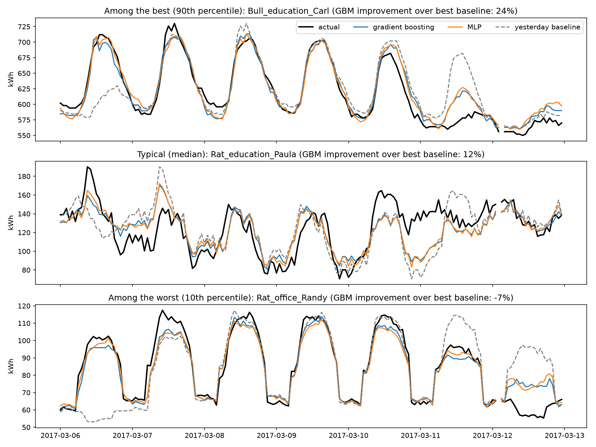
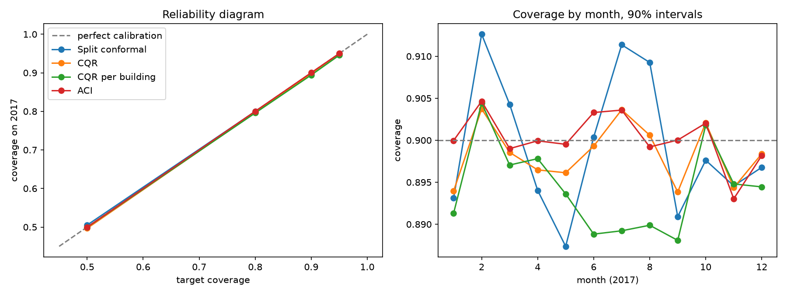
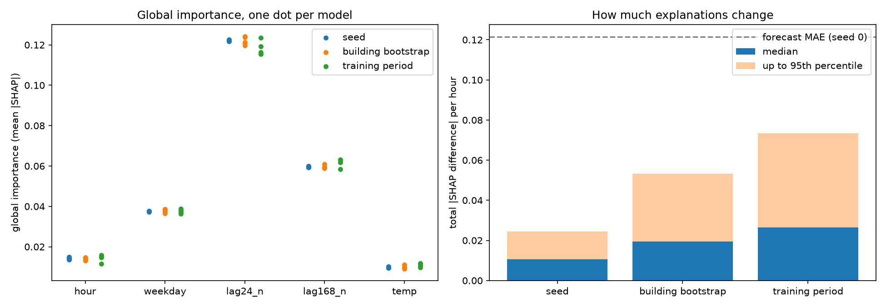

# Trustworthy building-energy forecasting

Calibrated uncertainty, stable explanations, and federated and edge deployment for
day-ahead building electricity forecasts, on public data.

**Status:** M1 (forecasting), M2 (uncertainty) and M3 (explanations) done. M4 (federated learning) is next.

| Part | Question | Status |
|---|---|---|
| M1 Forecasting | Can a model beat strong naive baselines, per building? | Done |
| M2 Uncertainty | Are the prediction intervals calibrated? | Done |
| M3 Explanations | Why does the model predict this, and is the explanation stable? | Done |
| M4 Federated learning | Can sites train one model together without sharing data (simulated)? | Planned |

## Data

[Building Data Genome Project 2 (BDG2)](https://github.com/buds-lab/building-data-genome-project-2),
hourly electricity meters for 2016–2017, licence CC BY-SA 4.0. The raw files are not
in this repository: download `electricity_cleaned.csv`, `weather.csv` and `metadata.csv`
into `data/raw/`.

Selection (details and plots in `notebooks/01_explore.ipynb`):

- Runs of identical values longer than 24 h are treated as missing (stuck or dead meters).
- Buildings are kept if at most 20% of hours are missing in **both** 2016 and 2017:
  **1,083 buildings on 14 sites** (`configs/train_buildings.csv`).
- Sites Panther and Swan are held out as unseen test sites. Shrew and Lamb are
  excluded because they have no usable 2017 data.
- Weather gaps of up to 24 h are interpolated; longer gaps stay missing.
- Timestamps are local time.

## Task and evaluation

- **Task:** each midnight, forecast the next 24 hourly values for each building.
- **Split by time:** train on 2016, test once on 2017. Model choices (for example the
  number of MLP epochs) are made on a validation period, November–December 2016.
- **Inputs:** hour, weekday, the load 24 h and 168 h earlier, and outdoor air temperature.
  Load values are divided by the building's mean load over the previous 7 days, so one
  global model can serve buildings of very different sizes.
- **Metric:** mean absolute error (MAE, kWh) per building, on hours with real values.
- **Baselines:** "yesterday" (same hour, 24 h earlier) and "last week" (same hour,
  168 h earlier). A model wins for a building only if it beats the **stronger** of the
  two for that building. Yesterday is the stronger baseline for 62% of buildings.

## Results (M1)

| Model | Buildings where it beats the stronger baseline | Median improvement over it |
|---|---|---|
| Gradient boosting (scikit-learn `HistGradientBoostingRegressor`) | 78.3 ± 0.3% | 11.5 ± 0.2% |
| MLP 7→64→64→1 (PyTorch) | 78.2 ± 1.1% | 11.0 ± 0.4% |

Mean ± standard deviation over 5 seeds, all 1,083 buildings. Both models are trained and
scored on exactly the same rows: hours where every input exists. On all test hours,
gradient boosting beats the stronger baseline for 76.3 ± 0.3% of buildings, because the
hours right after data gaps are harder.



The three buildings are picked by rule (90th percentile, median and 10th percentile of
improvement), not by hand.

**Takeaways**

- The two models are equally often better than the baselines. Gradient boosting has a
  slightly higher median improvement and is 3–4 times more stable across seeds.
- On a 100-building sample the MLP was clearly behind (73.2 ± 4.3%). With all buildings
  it caught up: the neural network needed much more data than the trees.
- Both models are weakest on weekends and on buildings with a strict weekly pattern. A
  single global model learns one average way to combine "yesterday" and "last week",
  and for an office that repeats every week this is worse than just copying last week.
  This motivates personalised models in M4.
- The MLP matters for later work: federated averaging needs model weights that can be
  averaged, which trees don't have.

**Limitations**

- Temperature is the measured value, not a forecast, so results are an upper bound on
  what a real weather forecast would allow. Removing temperature changed MAE very little
  on the building checked.
- One test year only. The held-out sites (Panther, Swan) are not evaluated yet.

## Results (M2: prediction intervals)

**Question.** A "90% interval" should contain the real value in 90% of hours. Is that true
for every building, every hour of the day and every season, not only on average?

**Setup.** Gradient boosting, all 1,083 buildings. Fit on January–October 2016, calibrate
on November–December 2016, test once on 2017. Width is relative to the building's mean load
over the previous 7 days (0.50 = the interval is half a normal hour's load wide). One seed.

**Methods.**
- *Split conformal*: point forecast ± one global error size from the calibration months.
- *Quantile GBM*: two models trained with the pinball loss for the 5% and 95% quantiles.
- *CQR* (conformalised quantile regression): the quantile interval, corrected on the
  calibration months.
- *CQR per building*: the same correction, computed separately for each building.
- *ACI* (adaptive conformal inference) on top of CQR per building: after each day, the
  interval for the next day gets wider if the building's interval missed more than 10% of
  hours, narrower if it missed less.

| Method (90% intervals) | Coverage | Mean width | Buildings below 80% | Worst building | Worst month |
|---|---|---|---|---|---|
| Split conformal | 89.9% | 0.535 | 160 | 29% | 88.7% |
| Quantile GBM | 89.4% | 0.467 | 127 | 61% | 89.0% |
| CQR | 89.8% | 0.474 | 116 | 61% | 89.4% |
| CQR per building | 89.4% | 0.500 | 31 | 70% | 88.8% |
| ACI on CQR per building | 90.0% | 0.524 | 0 | 89% | 89.3% |



**Takeaways**

- **Average coverage hides failures.** Split conformal covers 89.9% overall, but 160 of
  1,083 buildings get less than 80%. On a 100-building sample it covered 94% at night and
  only 85% at 14:00, because one fixed width is too wide for quiet hours and too narrow for
  busy ones.
- **Each fix addresses one group.** Quantile models adapt the width to the hour.
  Calibrating per building cuts the buildings below 80% from 116 to 31. ACI fixes the
  season: calibration on November–December does not represent summer, and per-building CQR
  drops to about 88.8% from June to September, while ACI stays between 89.3% and 90.5% in
  every month.
- **The price is width.** ACI intervals are about 10% wider than CQR (0.524 vs 0.474).
- **Heavy tails.** On the 100-building sample, 95% intervals were about 4.3 times wider
  than 50% intervals; a normal distribution would need about 2.9 times.

**Limitations**

- ACI's per-building coverage is close to 90% partly by construction: it steers each
  building's long-run miss rate. The informative checks are by hour and by month.
- ACI updates once per day (the forecasts are made at midnight for the next day), so it
  reacts to a bad day only afterwards. When it asks for more than the largest calibration
  error, the interval is capped there instead of becoming infinite.
- Apart from ACI, no method has a coverage guarantee on 2017: the guarantee of split
  conformal needs calibration and test data to be exchangeable, and time series are not.
- One seed; measured temperature instead of a weather forecast (as in M1).

## Results (M3: stable explanations)

**Question.** SHAP values say how much each input pushed a forecast up or down. If I train
the model again with a different seed, other buildings or other months, do the explanations
stay the same? An explanation that changes when nothing important changed is not one to trust.

**Setup.** The gradient boosting model from M1, all 1,083 buildings. Exact interventional
Shapley values (all 32 subsets of the 5 inputs, background of 100 hours of 2016), computed by
hand and checked for additivity. Explained hours: 2,000 random hours of 2017. Three sources of
variation, retraining the model each time:

- *Seed*: 5 seeds, same data.
- *Building bootstrap*: 5 models, each trained on 1,083 buildings drawn with replacement
  (about 680 different buildings each).
- *Training period*: 4 models trained on 6-month windows of 2016 (Jan-Jun, Mar-Aug,
  May-Oct, Jul-Dec).

Metrics fixed before the experiments: Spearman correlation of the global importances
(mean |SHAP|), agreement on the top-2 inputs, and the cosine similarity of the SHAP vectors of
the same hour. Added after the first results: the total |SHAP difference| per hour, in the
same unit as the forecast.

| Source of variation | Models | Spearman (min) | Top-2 agreement | Cosine median / 5th pct | Total \|SHAP diff\| median / 95th pct |
|---|---|---|---|---|---|
| Seed | 5 | 1.00 | 100% | 0.999 / 0.988 | 0.011 / 0.024 |
| Building bootstrap | 5 | 1.00 | 100% | 0.997 / 0.951 | 0.020 / 0.053 |
| Training period | 4 | 1.00 | 100% | 0.994 / 0.923 | 0.026 / 0.073 |

For scale: the forecast error (MAE) is 0.121 for every model (0.121-0.123).



**Takeaways**

- **The global story is stable.** All 14 models rank the inputs the same way: yesterday's load
  (lag24) first, last week's load (lag168) second, then weekday, hour and temperature.
- **Which months the model sees matters most.** Hour-level explanations move most between
  training periods: for 5% of hours the explanation changes by more than 0.073, about 60% of
  the typical forecast error, while the forecasts barely change.
- **More buildings make explanations more stable, more months do not appear to.** On a
  100-building sample the building bootstrap was the largest source (0.030 / 0.125) and hour
  and temperature swapped places. On all buildings it shrinks to 0.020 / 0.053 and the ranking
  is fixed, while the training-period effect stays about the same (0.027 vs 0.026).
- **Explanations are locally smooth.** Adding noise of 10% of each input's typical spread to
  lag24, lag168 and temperature changes the explanation by 0.018 (median); only 5% of hours
  get a noticeably different explanation with an almost unchanged forecast.

**Limitations**

- Interventional SHAP mixes the hour being explained with background hours, which can create
  unrealistic inputs (yesterday's load from one hour, last week's from another). It explains
  the model, not the building.
- The seed test is weak: seeds only change the 10% of rows held out for early stopping.
- The 6-month models differ in season and in which half of the year they miss; the
  experiment does not separate the two.
- Cosine similarity is unreliable for very small SHAP vectors (hours near the average
  forecast); this is why the total difference was added, after the first results.
- Hours where both lags are missing get very poor forecasts (error 1.67 vs 0.11 on a
  100-building sample, 0.04% of test hours) and the least stable explanations.
- One background sample of 100 hours; 2,000 explained hours.

## Reproduce

```bash
python -m venv .venv
source .venv/bin/activate
pip install -r requirements.txt
```

1. Run `notebooks/01_explore.ipynb`. It writes the cleaned data to `data/processed/`.
2. `python scripts/train_gbm.py`: gradient boosting on all test hours, 5 seeds.
3. `python scripts/train_nn.py val`: validation run to choose the number of MLP epochs.
4. `python scripts/train_nn.py`: MLP and gradient boosting on the same rows, 5 seeds each.
5. `python scripts/plot_forecast_week.py`: the forecast figure.
6. `python scripts/m2_intervals.py`: M2 intervals, 5 methods × 4 levels, and the M2 figure.
7. `python scripts/m3_stability.py`: M3 explanation stability (seeds, buildings, periods, noise) and the M3 figure.

Every experiment, including the ones that didn't work, is recorded in `EXPERIMENT_LOG.md`.

## Repository

```
configs/        building list
notebooks/      01_explore (data cleaning), 02_first_model (first models)
src/features.py feature table for one building
scripts/        training and plotting scripts
results/        tables (per-building MAE) and figures
data/           raw and processed data (not tracked by git)
```

## Data citation

Miller, C., Kathirgamanathan, A., Picchetti, B. et al. *The Building Data Genome Project 2,
energy meter data from the ASHRAE Great Energy Predictor III competition.*
Scientific Data 7, 368 (2020).
